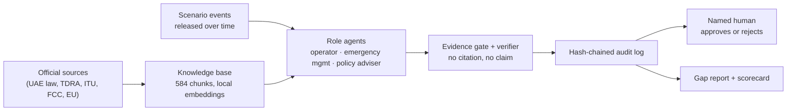

# Alert Governance Stress-Test

**Forty thousand phones buzz with an "Emergency warning". Nobody can say who sent it. We asked an AI that is only allowed to read the rulebook.**

> This project does not assess UAE institutions. It tests whether a published-policy knowledge base enables accountable, evidence-grounded coordination during a hypothetical public-alert governance failure.

`FICTIONAL SIMULATION` · Built for the ITU AI for Good Lab Hackathon (UAE) · [Open the viewer](https://vrxshxli.github.io/itu-alert-governance/) · [Technical report](submission/technical_report.pdf) · [Demo video]([VIDEO URL])

---

## The thirty-second version

When a public alert goes wrong, the hardest question is rarely technical. It is *"whose job is this?"* Who confirms the alert was false, who cancels it, who tells the public, and who tells the operator what to do?

Large language models are very good at answering that question confidently. That is precisely the problem.

So we built a system that is not allowed to be confident without a receipt. Every claim must cite a specific provision from a published official document, every citation is checked by a verifier, every step is written to a tamper-evident log, and nothing becomes a decision until a named human approves it.

Then we ran it through a fictional crisis, next to a plain LLM with no documents, and counted.

**The headline is not that the AI knew who was in charge. It is that the grounded system knew when the documents did not say, and said so.**

---

## The scenario: thirty minutes in Northvale

Northvale is a fictional district. Information arrives in pieces, and deliberately unevenly: each role sees only what it would plausibly see.

| Time | Who sees it | What they learn |
|---|---|---|
| t+0 | Telecom operator | ~40,000 handsets received an "Emergency warning". The operator's request log has no matching request. |
| t+4 | Emergency management | Unverified social-media reports. Some residents are leaving work. |
| t+9 | Telecom operator | The message passed through the shared alert gateway with no authenticated originator. |
| t+15 | Emergency management, policy adviser | Two municipal offices ask: is this real, and should residents act? |
| t+22 | Telecom operator | The vendor finds a test-mode setting left on, and says it cannot recall a delivered message. |
| t+30 | Emergency management, policy adviser | Journalists ask who will tell the public it was an error. Nobody has an answer yet. |

Notice the shape of it: the operator knows *what* happened, the emergency managers know *what the public is doing*, and the two halves never meet on their own. That gap is the experiment.

---

## How it works



Five rules hold the whole thing together:

1. **No citation, no claim.** An agent that cannot point to a provision does not get to assert a mandate. It may say "not established", and that is treated as an honest answer, not a failure.
2. **Silence is a finding.** When the published documents do not establish who is responsible, the system reports that as a gap in the public record, not as a guess about how any institution actually works.
3. **The AI proposes; a named human disposes.** Agents only ever write *pending* proposals. Approval requires a person's name, and decisions are permanent.
4. **Tamper-evident by default.** Every audit record carries the hash of the one before it. Edit a single line and the chain breaks, loudly.
5. **Authority is encoded, not assumed.** Repealed laws are historical context only. Where the Arabic text is authoritative, English renderings are labelled as translations in every citation (`kb/AUTHORITY_RULES.md`, enforced in code and tests).

---

## What we found

Same scenario, same roles, same information, same verifier. One run per condition.

| | Plain LLM (no documents) | Grounded system |
|---|---|---|
| Claims made | 28 | 151 |
| Citation validity (strict) | 9/28 (32.1%) | 146/151 (96.7%) |
| Mandate claims that pass | 4/16 | 86/91 |
| Unsupported mandate claims left in the output | **12** | **0** |
| Missing mandates correctly flagged (of 4) | 4 | 4 |
| Verifiable policy gaps | 0 | 5 |

The plain model was not dishonest. It flagged the same four unanswered questions the grounded system did. But it also asserted twelve mandates it could not support, and a crisis is exactly when a confident wrong answer about authority does the most damage.

**The four questions the published sources do not answer:**

1. Which body issues or authorises a public alert.
2. Which body cancels or corrects an alert already delivered, and how.
3. Which authority is the "competent authority" that directs an operator in a public emergency.
4. What the Executive Regulation on event classification and each body's role actually says (it is not in the public corpus we could read).

The full evidence-linked gap report is in [`report/gap_report.md`](report/gap_report.md); the numbers and their caveats are in [`report/scorecard.md`](report/scorecard.md).

### Read this before quoting any number

We would rather you trust these results a little than believe them too much.

- **One run per condition.** These are counts, not a statistical comparison. No significance is claimed.
- **Some choices were made after seeing early results**, mainly to make the baseline *fairer* (it was originally scoring 0%, partly through our own fault). Every such change is disclosed in [`docs/CHANGELOG_DECISIONS.md`](docs/CHANGELOG_DECISIONS.md).
- **The verifier comes from the same model family as the agents.** The independent check is a human spot check of 20 claims: [SPOT-CHECK RESULT].

---

## See it, run it, check it

**Just look (no setup, no key):** open the [hosted viewer](https://vrxshxli.github.io/itu-alert-governance/), or open `docs/index.html` in any browser. It is read-only and sends nothing anywhere.

**Run the tests (no key, no network):**

```bash
python3 -m venv .venv
source .venv/bin/activate          # Windows: .venv\Scripts\activate
pip install -r requirements.txt
python -m pytest -q tests          # 81 tests
```

**Open the local viewer with the approval buttons:**

```bash
python scripts/serve_viewer.py     # http://127.0.0.1:8765, binds to your machine only
```

**Reproduce everything from scratch:** needs your own API key, a local embedding model and the official documents fetched to your machine. `scripts/fetch_sources.sh` downloads each one and checks it against a recorded sha256, so you know you are reading exactly what we read.

```bash
python scripts/build_kb.py
python scripts/run_retrieval_tests.py
python scripts/run_scenario.py     # live model calls; costs money; creates a new run id
python scripts/make_report.py
```

The reported run is `run-20261108-200619-f7608f8d`. Two earlier runs stay in `audit/runs/` for transparency; they used a less fair baseline and are not the reported results.

---

## Where things live

| Path | What it is |
|---|---|
| `scenario/` | The six events and the scorecard logic |
| `agents/` | Role agents, evidence gate, verifier, approvals, audit chain, gap analyst |
| `kb/` | Source registry (`sources.md`, `sources.yaml`), authority rules, chunking, embeddings, retrieval |
| `audit/runs/` | Hash-chained records of every run (please do not edit; the chain will notice) |
| `report/` | Gap report, scorecard, spot-check sheet |
| `viewer/` | Source of the viewer; `docs/index.html` is its static export |
| `submission/` | Technical report, demo script, checklist |
| `third_party/itu_ai_readiness/` | ITU AI Readiness reference code, unmodified, MIT licence |
| `tests/` | 81 tests, no network required |

---

## What is deliberately not in this repository

An unusual section, because the absences are design decisions.

- **No UAE source text.** The publishers reserve all rights, so the repo holds URLs, metadata and hashes, plus the scripts that fetch the documents locally. Redistributable sources (the FCC report, EU Directive extracts) are handled with attribution.
- **No API key, and no backend.** A hosted backend would put a spendable key on a public server and would need source text we cannot redistribute. The viewer is a static export on purpose.
- **No knowledge-base export, yet.** It contains source text, so it goes to the organisers only once they confirm how it may be used.

---

## Team

[TEAM NAME] · [NAMES, AFFILIATION, CONTACT]

## Disclaimer and licence

The scenario is fictional. It contains no real internal information, describes no real incident, and is not legal or official advice. See [`DISCLAIMER.md`](DISCLAIMER.md). Our code is MIT-licensed ([`LICENSE`](LICENSE)); third-party code keeps its own licence.

> The system does not decide who is right. It shows what the published evidence supports, what it does not establish, and where human authority is required.
